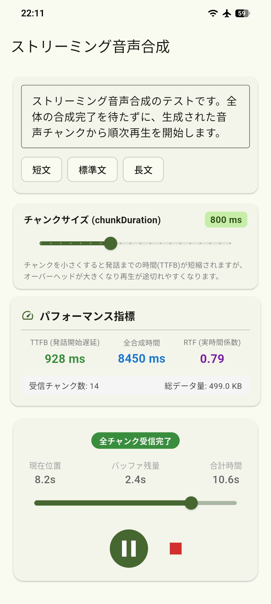

# voicevox_flutter_example_streaming

voicevox_flutter を使ったサンプルアプリ。VOICEVOX CORE 0.17.1で搭載されたストリーミング音声合成機能を試すことができます。

  

## 使い方
[VOICEVOX VVMリポジトリ](https://github.com/VOICEVOX/voicevox_vvm) から VVM 音声モデルをダウンロードして、`assets/model` フォルダに入れてください。  
- `assets/open_jtalk_dic_utf_8-1.11`は https://open-jtalk.sourceforge.net/ の Dictionary for Open JTalk version 1.11: Binary Package (UTF-8) から入手できます。
